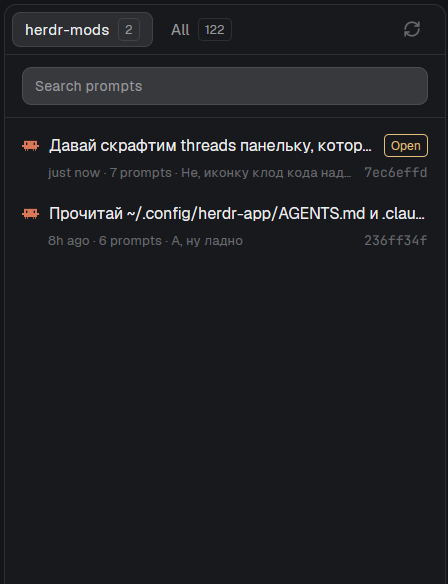

# Claude Threads

Your past Claude Code sessions in [Herdr Desktop](https://herdr.dev/), newest first, for the repo you're in or for every folder. Click one to pick it up again in a new tab, in the folder it ran in. It's for the tab you closed an hour ago and the conversation from last week you half remember.



- **Two lists:** the shown space's repo, and **All**, with each session's folder.
- **Search** across every prompt you typed in a session, not just its first one. The row then shows the prompt that matched.
- **Each row:** the session's first prompt, how long ago it was used, how many prompts it has, and its last prompt.
- **Click** opens a tab running `claude --resume <id>`. **Shift-click** forks it (`--fork-session`): a new session with the same history, the original left as it was.
- **Already open:** a session running in a terminal says **Open** on the right, and a click goes to its tab instead of starting it twice.
- Sessions Claude Code has cleaned up, or whose folder is gone, aren't listed, since they can't be resumed.

It reads `~/.claude/history.jsonl`, where Claude Code keeps every prompt with its session and folder, so there's nothing to install and the big session files are never opened. Inspired by [Atuin Threads](https://github.com/atuinsh/herdr-atuin-threads), without needing Atuin.

## Install only this mod

Copy this prompt into your Herdr agent:

> Read ~/.config/herdr-app/AGENTS.md, then add this mod: https://github.com/munza/herdr-mods/tree/main/claude-threads

Requirements: Claude Code (`claude` on your PATH) and Git.

Read [RECIPE.md](RECIPE.md) and the source before installing. The mod reads `~/.claude/history.jsonl`, the file names under `~/.claude/projects/` and `~/.claude/sessions/*.json`, and never writes to them. It runs `git rev-parse` to find the shown space's repo and `hc get` for each Claude terminal to see which session it runs. On a click it opens a tab or a space running `claude`. It doesn't reach the network.

From this folder, `./sync.sh` copies the mod into Herdr (`.\sync.ps1` on Windows), then:

```sh
herdr-app check ~/.config/herdr-app/mods/claude-threads
```

### Open it

`mod.json` has `place: none`, so nothing docks by itself. It opens as a 400×560 popup with:

```sh
herdr-app do mod.open --name claude-threads
```

[Estro](../estro/RECIPE.md) has it as the Threads panel. In a layout of your own, add a block to a panel stack and a [Better Tabs](../better-tabs/README.md) button for it:

```json
{ "id": "threads", "type": "block", "content": { "mod": "claude-threads" } }
```

```json
{ "id": "threads", "label": "Threads", "icon": "mods/claude-threads/icons/threads.svg", "group": "panels",
  "action": { "type": "panel", "container": "panel", "stack": "panel-body", "target": "threads" } }
```

## Limits

- Only this computer's sessions. In a space on another machine, a click opens a new space here in the session's folder.
- The title is your first prompt, not the name Claude Code shows in `/resume`, and the model isn't shown: both live only in the session files, which can be 100 MB each.
- The list reloads every minute and on the refresh button.

## Development

```sh
node --test claude-threads/tests/threads.test.cjs claude-threads/tests/packaging.test.cjs
```
