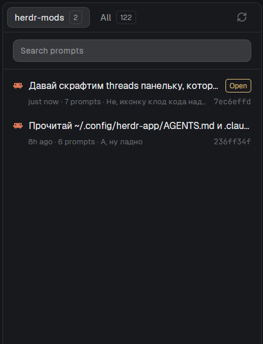

# Claude Threads

A list of past Claude Code sessions, newest first, for the repo of the space you are looking
at, or for every folder, with a search across every prompt. Each row is one session: Claude's
icon and its first prompt, then how long ago it was used, its prompt count and its last prompt, with the start of
its id on the right. Click a row and a new tab opens in that space, in the session's folder,
running `claude --resume`; shift-click forks it. A session already running in a terminal says
Open on the right, and a click goes to it. Drawn like this repo's other panels (Branch PR, Branch
Issue), it sits in a side panel and opens as a popup too.

## What you see

A card on the `background` colour, radius 10, 1px `border`, base type 13px. Top to bottom:

- **Header**, 42px, 14px side padding, a 1px `border` rule under it:
  - Two pills, 4px apart, pulled 8px left to line up with the rows: 29px tall, 10px side
    padding, radius 7, 12.8px type, 7px gap to a count badge (10px type, 5px side padding,
    radius 4, 1px `border`, `muted`). The first is the repo folder's name and its session
    count (`herdr-mods 2`), or `This space` with no badge when there is no space. The second
    is `All 122`. The chosen one is `foreground` on `raised` with a `border` outline, the
    other `muted`; both get `hover`. With a search, the counts are of the matches.
  - On the right a 26px square button, radius 6, `dim` (`hover` and `foreground` under the
    pointer), tooltip "Refresh sessions", with `icons/refresh.svg` (Lucide's refresh-cw) at
    15px, spinning every 900 ms while a load runs.
- **Search row**, 14px side and 10px vertical padding, a 1px `border` rule under it: a field
  32px tall, 10px side padding, radius 8, 1px `border`, `input` background, 12px type,
  placeholder `Search prompts`.
- **The list**, scrolling, 6px padding, 2px between rows. Each row is two lines on a radius 7
  card, 8px side and 7px vertical padding, 3px between lines, `hover` under the pointer:
  - Line one: Herdr's `icons/claude.svg` at 14px in full colour, an 8px gap, the first prompt
    in `foreground`, truncated; `(untitled)` when every prompt was a `/command`. When the
    session runs in a terminal, an `Open` badge on the right: the count badge's shape, its
    border and text in `working`, tooltip "Running in a tab: click to go to it".
  - Line two, indented 22px, 11px `dim`: `·`-joined, the age (`just now`, `12m ago`,
    `3h ago`, `6d ago`), in All the folder's name, `4 prompts` (`1 prompt`), then the last
    prompt, or with a search the last prompt that matched, truncated; the prompt is left out
    when it is the first one again. On the right, in the terminal font, the first 8
    characters of the session id.
- In place of the rows: before the first load, a 20px spinning refresh icon over
  `Loading sessions…`, centred; otherwise 12px `dim` text with 8px padding,
  `No sessions in herdr-mods yet.`, `No sessions yet.` or `No matching sessions.`; a read
  error in `ansi1`.
- **Footer**, 34px, 14px side padding, a 1px `border` rule above it, 11px `dim`:
  `Click resumes · Shift-click forks` on the left; `Updated just now` (`Updating…` while a
  load runs, the full time as a tooltip) on the right.

As a popup it is 400×560 px, centered, dimming the window.

## How it behaves

- No agent statuses: a session is a stored conversation. The only motion is the refresh icon.
- Click: if the session is running in a Claude terminal still listed in `agents()`,
  `pane.focus {terminal}`. Otherwise `tab.new` in the shown space with `folder` = the
  session's folder (backslashes on Windows), `name` = the first 28 characters of the first
  prompt (none for `(untitled)`), `argv` = `["claude", "--resume", <id>]`; shift adds
  `--fork-session`. When the shown space is on another machine, `space.new` with the same
  `folder` and `argv` and `machine: ""` instead.
- The pills switch the list; the choice and the search are not saved.
- The list reloads every 60 s and on the refresh button. It re-renders by itself when the shown space changes.
  Which sessions are open is worked out again whenever the set of Claude agents changes.
- The repo filter: the shown space's place is its first terminal's live folder, else the
  space's folder; `git -C <it> rev-parse --show-toplevel` gives the root, once per folder;
  sessions whose folder is the root or inside it (Windows paths compared without case and
  with either slash) are the space's. Outside a repo, the folder itself is used.

## Built from

- `mods/claude-threads/main.js`: one `View`, default export. `threads.js`: pure functions,
  `sessionsFromHistory`, `projectDir`, `searchSessions`, `openSessions`, `oneLine`, `ago`.
  `paths.js`: this repo's shared path helpers. `ui.js`: the frame, header pill, icon button,
  search field, row and footer of Branch Issue's design kit, copied with only what this mod
  uses. `icons/refresh.svg` (Lucide, ISC) and `icons/threads.svg`, a 24×24 speech bubble with
  two lines, stroked `currentColor`, for a toolbar button. `mod.json`: `$schema`
  `./mod.schema.json`, `version`, `"place": "none"`, `"title": "Threads"`,
  `"overlay": { "width": 400, "height": 560 }`; `mod.schema.json` describes it (no settings).
- Data, all on this computer, with `fs/promises` (`readFile`, `readdir`, `exists`):
  - `~/.claude/history.jsonl`: one JSON line per prompt, `{display, timestamp, project,
    sessionId}`. Grouped by `sessionId`: `project`, the newest `timestamp`, the first and last
    `display` that doesn't start with `/`, the count, and every `display` for search.
  - `~/.claude/projects/<dir>/<sessionId>.jsonl`, where `<dir>` is the folder with every
    character but `A-Za-z0-9` turned into `-`: only its existence, from one `readdir` per
    folder. A session without one, or whose folder no longer `exists`, is left out.
  - `~/.claude/sessions/<pid>.json`: `{pid, sessionId, ...}` for each running Claude.
- `herdr`: `agents()` (those with `app` `claude-code` and an address without `/`), `hc(["get",
  <address>, "--json"])` for `foreground.pid`, `spaces()`, `panes()`, `run` (`tab.new`,
  `space.new`, `pane.focus`), `exec` (git), `theme()`, `home()`. `gpui-kit`: `View`, `div`,
  `svg`; `gpui-base`: `v_flex`, `h_flex`, `InputState`, `Input`; `herdr` `settings()` for the terminal font.

## Watch out

- `readTextFile` stops at 1 MiB and `history.jsonl` is several; read it with
  `fs/promises` `readFile(path, "utf8")`.
- Never open the session files themselves: they reach 100 MB. `fs/promises` has no partial
  read and no `stat`.
- Claude Code deletes old session files, so most of the history's sessions can't be resumed
  (122 of 1357 on the machine this was built on). Resuming one opens a tab that closes at
  once, taking the error with it: filter them out.
- Claude writes `history.jsonl` while you read it; skip a line that doesn't parse.
- A crashed Claude leaves its `sessions/<pid>.json` behind: a session is open only when a live
  terminal's foreground pid matches.
- Search runs over every prompt. Herdr re-renders on every agent status change, so keep the
  result until the query or the list changes.
- `mod.json` must say `"place": "none"`, or Herdr docks a copy into the shown layout.
- Elements need `.id()` before `.hover()` or `.on_click()`. `.when()` takes a boolean.

## Done when

- `herdr-app check mods/claude-threads` passes, and `node --test` passes on `tests/`.
- `mod.open {name: "claude-threads"}` shows a 400×560 popup with two pills, a refresh
  button and a search field; Esc closes it.
- The first pill names the shown space's repo and lists only sessions in it; switching spaces
  changes it. All lists every session whose file and folder exist, newest first.
- The session you're talking to says Open; clicking it focuses its terminal.
- Clicking a closed session opens a tab named after its first prompt running
  `claude --resume <id>`, and Claude shows the old conversation. Shift-click starts a new
  session id with the same history.
- Typing a word from a later prompt keeps that session and shows that prompt on line two.
